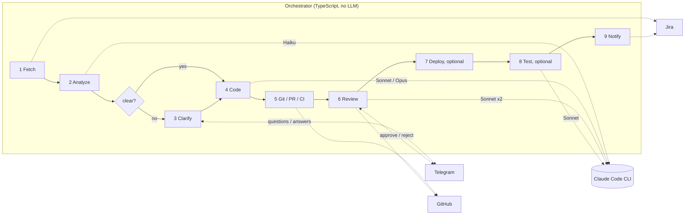

# jira-acp

> Turn one Jira ticket into one reviewed pull request, with a person approving the merge and the cost of the ticket measured.

[](https://github.com/bigbearman/jiraACP/actions/workflows/ci.yml)
[](https://nodejs.org)
[](LICENSE)

---

`jiraACP` is a pipeline that takes a Jira ticket to **a reviewed pull request**. It is designed so that **a person approves every merge** and **the cost of each ticket is measured**. It shows how to fit an LLM into a delivery process a team already runs. It is not an autonomous ticket-to-production bot.

The product direction, scope and principles are in [docs/PRODUCT.md](docs/PRODUCT.md). The code does not fully meet those two goals yet; [section 6](#6-known-limitations) says exactly where.

## 1. The problem

Small teams lose a lot of time on routine Jira tickets. Someone has to read the ticket, work out what it means, write the change, open a pull request, get it reviewed, and then update Jira. Most of that is coordination, not engineering. Handing it to an LLM agent only works if a person keeps control of what gets merged and can see what each ticket costs.

Give `jiraACP` a ticket key and it:

1. checks whether the ticket is clear enough to work on, and asks you on Telegram if it isn't,
2. has Claude Code implement the change on a new branch,
3. pushes the branch, opens a PR and waits for CI,
4. runs two independent AI reviews of the PR, and asks you on Telegram to approve or reject (today only when the reviews find major issues, see [section 6](#6-known-limitations)),
5. merges the PR and updates Jira.

Deploy and end-to-end UI tests exist as optional stages, off by default, and are outside the core scope.

Every step is written to an append-only event log, so a crashed run can be resumed and a finished run can be replayed.

## 2. Demo

> **TODO demo:** a short (< 2 min) recording of one ticket going through the pipeline on a test repository. Not recorded yet.

## 3. Architecture

`jiraACP` is a deterministic TypeScript **orchestrator** that runs nine stages in order. Four of the stages call Claude through the [Claude Code CLI](https://claude.ai/code) (`claude --print`). The others are plain integrations with Jira, GitHub and Telegram.



### Roles

The pipeline is often described as five agents. Here is how those roles map to the code:

| Role | Where it lives | LLM? | Model |
|------|----------------|------|-------|
| Coordinator | `src/pipeline/orchestrator.ts`: stage sequencing, state, locks, failure handling | No, deterministic code | none |
| Analyzer | Stage 2 `analyze`: scores ticket clarity as JSON | Yes | Haiku |
| Coder | Stage 4 `code`: implements the ticket, creates the branch and commits | Yes | Sonnet, or Opus for complex tickets ([ADR-0001](docs/adr/0001-model-selection-by-cost.md)) |
| Reviewer | Stage 6 `review`: two reviewers in parallel, one for logic and one for code quality | Yes, 2 calls | Sonnet |
| Tester | Stage 8 `test`: Playwright tests run by an agent. **Off by default** (`test.enabled`) | Yes | Sonnet |

The other stages (fetch, clarify, git, deploy, notify) make no LLM calls.

### Stages

| # | Stage | What it does | Runs when |
|---|-------|--------------|-----------|
| 1 | fetch | Reads the ticket from Jira and writes `ticket-context.md` | always |
| 2 | analyze | Clarity score from 0 to 1. Tries JSON once, retries once, then falls back to regex, then to a default score | always |
| 3 | clarify | Sends questions to Telegram and waits for `/answer` | score below `clarityScoreThreshold` (default 0.7) |
| 4 | code | Claude Code edits the workspace, creates the branch and commits | always (skipped in `--dry-run`) |
| 5 | git | Pushes, opens the PR, requests reviewers, polls CI | always |
| 6 | review | Two AI reviews, then a human approval gate if they find major issues, then merge ([ADR-0002](docs/adr/0002-human-approval-via-telegram.md)) | always |
| 7 | deploy | Runs `deploy.command` and a health check, rolls back on failure | `deploy.enabled` |
| 8 | test | Playwright tests through an agent, with retries | `test.enabled` |
| 9 | notify | Moves the Jira ticket to Done, comments, reassigns, posts to Telegram | always |

If a stage fails, the run stops and you are told about it; see [ADR-0003](docs/adr/0003-stop-and-report-on-failure.md).

There are two binaries:

| Binary | Purpose |
|--------|---------|
| `jiraACP` | Pipeline CLI |
| `jiraACP-mcp` | Jira MCP server with 6 tools (`jira_get_tasks`, `jira_get_ticket`, `jira_get_transitions`, `jira_transition_ticket`, `jira_add_comment`, `jira_reassign`). `jiraACP init` registers it in the workspace `.mcp.json` |

## 4. Run it

**You need:** Node.js 20 or later, [Claude Code](https://claude.ai/code) installed and logged in, a Jira Cloud API token, a GitHub token, and a Telegram bot token plus chat ID.

First, a one-time setup. The interactive wizard writes `~/.jira-acp/projects/<name>.json`:

```bash
git clone https://github.com/bigbearman/jiraACP.git && cd jiraACP
npm ci && npm run build && npm link   # puts `jiraACP` and `jiraACP-mcp` on your PATH
jiraACP init
jiraACP doctor                         # checks every integration
```

Then run a ticket with one command:

```bash
jiraACP run PROJ-123
```

Add `--dry-run` to go through the stages without calling the code agent, merging or changing Jira. `--from` and `--to` let you run only part of the pipeline.

Environment variables are listed in [`.env.example`](.env.example). The pipeline itself reads its credentials from the project config file. The env vars are for the MCP server, the webhook server and logging.

## 5. Measured results

| What | Result | How to reproduce |
|------|--------|------------------|
| Unit and integration tests | 22 test files, **351 tests passing** | `npm test` |
| Build (ESM + type declarations) | passes | `npm run build` |
| Secret scan of the full git history | no findings | CI job `secret-scan` (gitleaks) |
| Token cost per ticket | **not measured yet**, see [docs/token-cost.md](docs/token-cost.md) | — |

No figures for time saved or ticket success rate are published, because none have been measured on real tickets yet.

## 6. Known limitations

The first two items are where the code does not yet meet the principles in [docs/PRODUCT.md](docs/PRODUCT.md). Both are being worked on next.

- **Not every merge needs a person yet.** If the two AI reviewers report fewer major issues than `github.majorIssueThreshold` (default 1), stage 6 merges the PR automatically. Until approval is mandatory by default, set the threshold to `0` to require approval for every PR. See [ADR-0002](docs/adr/0002-human-approval-via-telegram.md). *Planned:* approval required for every merge by default; auto-merge only behind an explicit opt-in flag.
- **Cost per ticket is not measured yet.** The agent runs with `--output-format text`, so no stage reports token counts. As a result, `jiraACP usage` shows no data and `pipeline.maxCostUsdPerRun` never triggers. *Planned:* record model and token usage per stage, so `usage` reports cost per ticket and the cost limit stops a run. See [docs/token-cost.md](docs/token-cost.md).
- **Only run against test repositories so far.** It has not been used on a production codebase or a real team backlog.
- **Model routing is a keyword heuristic.** Stage 4 switches to Opus when the ticket mentions two or more words such as `auth`, `payment`, `migration` or `schema`. Nothing else is configurable.
- **Deploy and UI tests are outside the core scope.** Both stages are off by default (`deploy.enabled`, `test.enabled`). When enabled, deploy and rollback commands are run without a shell and without arguments, so `deploy.command` must be a single executable, such as a script path, not `npm run deploy`.
- **Some config fields are accepted but not used:** `workspace.allowedPaths`, `pipeline.failOnDeployFailure`, `pipeline.skipClarificationIfClear`, `notifyOnStages`. *Planned:* implement them or remove them from the schema.
- **`npm run typecheck` reports errors** that the build does not catch, including in the `sprint` and `triage` commands. Treat `sprint`, `triage`, `dashboard` and `schedule` as experimental: they are outside the core scope. *Planned:* a clean typecheck in CI.
- **Secrets are stored in plain text** in `~/.jira-acp/projects/<name>.json`. Keep that file private (`chmod 600`).

---

## CLI reference

### Pipeline

```bash
jiraACP run <ticketKey> [--project <name>] [--from <stage>] [--to <stage>] [--dry-run] [--no-confirm]
jiraACP sprint [--project] [--sprint] [--parallel 2] [--filter <jql>] [--dry-run]   # experimental
jiraACP triage [--project] [--sprint]                                               # experimental
```

### Control and monitoring

```bash
jiraACP status [ticketKey]      # daemon status, or pipeline state for a ticket
jiraACP logs [ticketKey] [-f]   # server logs, or a ticket's pipeline log
jiraACP dashboard [--watch]     # terminal UI of active runs
jiraACP replay <ticketKey>      # replay a run's event log
jiraACP usage [--month YYYY-MM] # token cost report (no data yet, see limitations)
jiraACP pause|resume|abort <ticketKey>
jiraACP cancel-clarification <ticketKey>
```

### Setup, config and server

```bash
jiraACP init [--dir <path>]
jiraACP doctor [--fix]
jiraACP update-context                 # regenerate CLAUDE.md from a codebase scan
jiraACP projects list|add|remove
jiraACP config get|list|set|edit
jiraACP schedule add --cron "0 9 * * 1-5" --project <name>
jiraACP schedule list|remove <id>
jiraACP start|stop|restart [--port 3110]   # background server (Telegram bot, schedules, webhooks)
jiraACP serve [--port 3110]                # same server in the foreground
```

## Configuration

`~/.jira-acp/config.json` holds optional global defaults. `~/.jira-acp/projects/<name>.json` holds one project's settings, and these override the global file. Here is a shortened project config:

```json
{
  "name": "my-saas",
  "jira": {
    "url": "https://myteam.atlassian.net",
    "email": "dev@myteam.com",
    "token": "<jira api token>",
    "projectKey": "PROJ",
    "clarityScoreThreshold": 0.7
  },
  "github": {
    "token": "<github token>",
    "owner": "myorg",
    "repo": "my-saas",
    "defaultBranch": "main",
    "autoMergeStrategy": "squash",
    "majorIssueThreshold": 1
  },
  "workspace": { "rootDir": "/path/to/codebase" },
  "telegram": { "botToken": "<bot token>", "chatId": "-1001234567890" },
  "pipeline": { "maxCostUsdPerRun": 2.0 }
}
```

The full schema is in [`src/config/schema.ts`](src/config/schema.ts).

## Human in the loop (Telegram)

| When | What you get | If nobody answers |
|------|--------------|-------------------|
| Clarity score below threshold | Questions plus a `/answer PROJ-123` template; one reminder at half the timeout | after `clarificationTimeoutMs` (1 h): `skip` (default; the run stops), `abort`, or `proceed-with-warning` |
| AI review finds major issues | Issue list with Approve / Reject buttons; reminders every 30 min, up to 3 | after 24 h: `abort` (default) or `merge-anyway` |
| A stage fails | Stage name and error | — |
| Cost reaches 80% of `maxCostUsdPerRun` | Warning (abort at 100%), currently inactive, see limitations | — |

Bot commands: `/run`, `/abort`, `/resume`, `/status`, `/logs`, `/tickets`, `/ticket`, `/projects`, `/archive`, `/verbosity`.

## Crash recovery

The state of each run is an append-only event log at `~/.jira-acp/runs/<project>/<ticketKey>/state.json`. Each ticket is guarded by a lock file opened with `O_EXCL`. After a crash, `jiraACP resume PROJ-123` detects the dead lock and restarts from the stage that was running.

## Security

- **Minimal env forwarding.** Subprocesses get an allowlist (`PATH`, `HOME`, locale, `GIT_*`, SSH agent, `ANTHROPIC_API_KEY`), never the full `process.env`. See `buildMinimalEnv` in `src/utils/process.ts`.
- **No shell interpolation.** Every subprocess is started as `spawn(bin, argsArray)`.
- **Atomic per-ticket locks**, so the same ticket cannot run twice at once.
- **Secret scanning in CI** with gitleaks over the full history.

## Design decisions

- [Product direction: scope, out of scope and principles](docs/PRODUCT.md)
- [ADR-0001: Choose the Claude model per stage by cost](docs/adr/0001-model-selection-by-cost.md)
- [ADR-0002: Human approval through Telegram](docs/adr/0002-human-approval-via-telegram.md)
- [ADR-0003: Stop and report on failure](docs/adr/0003-stop-and-report-on-failure.md)

## Development

```bash
npm ci
npm run build
npm test
```

`docs/dev-process/` holds the planning notes from the agent-assisted build of this tool. `docs/archive/` holds earlier feature specs; they are kept for history and are not a roadmap.

## License

[MIT](LICENSE) © Kien Duong
